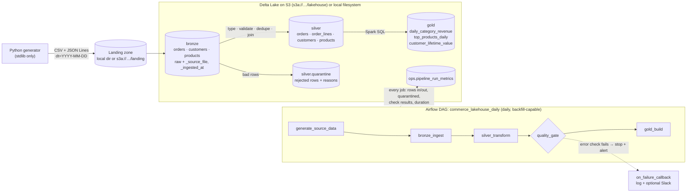

# Commerce Data Lakehouse Pipeline

A daily batch pipeline for e-commerce data, built on a medallion (bronze/silver/gold) lakehouse:

- **PySpark + Delta Lake** for processing and storage
- **Airflow** for orchestration, with retries, alerting and backfills
- **AWS S3** for storage, provisioned with **Terraform** (or the local filesystem for development)
- **Data quality checks**, a **quarantine** table, and per-run **metrics**, all through one shared Python library

Everything runs on a laptop in Docker. The only cloud resources are an S3 bucket and an IAM user,
which cost close to nothing (see [Cost](#cost-and-teardown)).

## Architecture



Every task runs `python -m <job> --ds {{ ds }}` and uses the shared library in
[`src/lakehouse_common/`](src/lakehouse_common/):

| Module | What it does |
|---|---|
| `config.py` | Builds every table and landing path from `LAKEHOUSE_STORAGE_ROOT` / `LAKEHOUSE_LANDING_ROOT` |
| `spark.py` | The only SparkSession builder: Delta, UTC, S3A, jars |
| `delta.py` | Idempotent writes: `overwrite_partition` (replaceWhere) and `merge_upsert` (MERGE) |
| `quality.py` | `not_null`, `unique`, `referential_integrity`, `value_range`, `row_count` |
| `metrics.py` | Writes `ops.pipeline_run_metrics` |
| `runner.py` | Job entry point: parse `--ds`, time the run, record metrics, stop Spark |
| `log.py` | JSON-lines structured logging |
| `alerts.py` | Failure alerts: log, plus Slack if a webhook is set |

## Stack and versions

| Component | Version | Note |
|---|---|---|
| Python | 3.11 | |
| Apache Spark (PySpark) | 3.5.9 | local mode, Scala 2.12, bundles Hadoop 3.3.4 |
| Delta Lake (`delta-spark`) | 3.3.3 | built for Spark 3.5 |
| `hadoop-aws` / `aws-java-sdk-bundle` | 3.3.4 / 1.12.262 | must match Spark's bundled Hadoop exactly |
| Apache Airflow | 3.3.2 | LocalExecutor, Postgres 16 for metadata |
| Java | Temurin 17 | |
| Terraform / AWS provider | ≥ 1.6 / ~> 6.0 | |

The versions are pinned in `requirements.txt`, `docker/Dockerfile` and `infra/terraform/versions.tf`.

## Repository layout

```
├── dags/commerce_lakehouse_daily.py   Airflow DAG (orchestration only)
├── src/
│   ├── generator/                     synthetic source data (stdlib only)
│   ├── jobs/                          bronze_ingest, silver_transform, quality_gate, gold_build, upload_landing
│   │   └── sql/gold/*.sql             gold business logic as plain Spark SQL
│   └── lakehouse_common/              shared library (see above)
├── tests/                             pytest, local filesystem only, no AWS needed
├── infra/terraform/                   S3 bucket + least-privilege IAM
├── docker/Dockerfile                  one image for Airflow, Spark jobs and tests
├── docker-compose.yml                 Postgres + Airflow
└── docs/standards.md                  naming, partitioning and data quality rules
```

## Setup

You only need Docker Desktop (with the WSL2 backend on Windows). Terraform and the AWS CLI are
only needed for the S3 setup.

```powershell
git clone <repo> ; cd commerce-lakehouse-pipeline
copy .env.example .env          # defaults to the local filesystem
docker build -f docker/Dockerfile -t commerce-lakehouse:dev .
```

## Tests

```powershell
docker run --rm -v "${PWD}:/opt/project" commerce-lakehouse:dev python -m pytest                       # everything (~10 min)
docker run --rm -v "${PWD}:/opt/project" commerce-lakehouse:dev python -m pytest -m "not integration"  # quick (~3 min)
```

The tests use small fixture DataFrames and the local filesystem only. They never touch AWS. They cover:

- the generator: deterministic output, volumes, exact counts of injected defects
- every data quality check
- each transformation: bronze → silver (every defect goes to quarantine), silver → gold (hand-checked numbers)
- idempotent reruns and MERGE behaviour on backfills
- the DAG's structure, the alert callback, metrics and S3A settings

The `integration` tests run whole pipeline days through Spark, so they're slow.

## Run locally

### With Airflow (the normal way)

```powershell
docker compose up -d --build    # wait ~1 min, then open http://localhost:8080 (no login locally)
```

Turn on `commerce_lakehouse_daily` in the UI, or trigger one day from the CLI:

```powershell
docker compose exec airflow airflow dags trigger commerce_lakehouse_daily --logical-date 2026-03-01T00:00:00+00:00
```

`ds` is the date part of `--logical-date`, so this run processes 2026-03-01. For a manual run, Airflow 3
sets the data interval from the time you trigger, not from the logical date, which is why every task
uses `{{ ds }}` and never `data_interval_start`.

### Without Airflow (one job at a time)

```powershell
$ds = "2026-03-01"
docker run --rm -v "${PWD}:/opt/project" commerce-lakehouse:dev python -m generator --date $ds
foreach ($job in "bronze_ingest", "silver_transform", "quality_gate", "gold_build") {
    docker run --rm -v "${PWD}:/opt/project" commerce-lakehouse:dev python -m jobs.$job --ds $ds
}
```

The output lands in `data/landing/` and `data/lakehouse/<layer>/<table>/`, both gitignored.

## Run on S3

1. **Provision the bucket and IAM user.** This needs admin credentials for your own account, used only
   for Terraform: an IAM user with `AdministratorAccess` (not the root account), stored in its own profile
   with `aws configure --profile lakehouse-admin`. Point Terraform at that profile for this shell:
   ```powershell
   $env:AWS_PROFILE = "lakehouse-admin"
   aws sts get-caller-identity                 # check you're the admin user, not root
   cd infra/terraform
   copy terraform.tfvars.example terraform.tfvars   # optionally set budget_alert_email
   terraform init
   terraform plan -out "$env:TEMP\lakehouse.tfplan"   # review: 10 resources, 11 with the budget
   terraform apply "$env:TEMP\lakehouse.tfplan"
   terraform output
   ```
2. **Create an access key for the pipeline user.** This isn't done in Terraform, because the secret would
   end up in the state file. This pipes the new key straight into the `commerce-lakehouse` profile, so the
   secret is never printed to the screen:
   ```powershell
   $key = (aws iam create-access-key --user-name commerce-lakehouse-pipeline --profile lakehouse-admin --output json | ConvertFrom-Json).AccessKey
   aws configure set aws_access_key_id $key.AccessKeyId --profile commerce-lakehouse
   aws configure set aws_secret_access_key $key.SecretAccessKey --profile commerce-lakehouse
   aws configure set region us-east-1 --profile commerce-lakehouse
   Remove-Variable key
   ```
   Then prove least privilege. The first command should succeed and the other two should fail with AccessDenied:
   ```powershell
   aws s3 ls s3://commerce-lakehouse-<account-id> --profile commerce-lakehouse
   aws s3 ls --profile commerce-lakehouse
   aws iam list-users --profile commerce-lakehouse
   ```
3. **Point the pipeline at S3** in `.env`, using the values from `terraform output`:
   ```
   LAKEHOUSE_STORAGE_ROOT=s3a://commerce-lakehouse-<account-id>/lakehouse
   LAKEHOUSE_LANDING_ROOT=s3a://commerce-lakehouse-<account-id>/landing
   AWS_PROFILE=commerce-lakehouse
   AWS_REGION=us-east-1
   ```
4. Run `docker compose up -d` and trigger the DAG as above. Docker Compose mounts `~/.aws` read-only, and no credential is ever copied into the image or the repo.
   Check that the container acts as the pipeline user, not your admin:
   ```powershell
   docker compose exec airflow python -c "import boto3; print(boto3.client('sts').get_caller_identity()['Arn'])"
   ```
   Two things to expect:
   - **Unpausing schedules one run** for the latest complete day, even with `catchup=False`. It writes to S3 like any other day.
   - **Airflow's metadata database remembers local runs.** It lives in the `airflow-db` volume, which survives
     `docker compose down`. A day that already succeeded locally counts as done, so a plain backfill skips it
     even though it was never written to S3. Add `--reprocess-behavior completed`, or start from a clean
     database with `docker compose down -v`.

How S3 access works:

- Spark talks to S3 through Hadoop's **S3A** connector (`s3a://`, not `s3://`), configured in [`spark.py`](src/lakehouse_common/spark.py).
- `hadoop-aws` must be the same version as the Hadoop that's built into PySpark (3.3.4). It was compiled against one exact AWS SDK bundle (1.12.262).
- Credentials come from the AWS SDK's default chain: environment variables, then the `AWS_PROFILE` profile, then instance or container roles.
- Delta on S3 uses a single-writer log store. That's why the DAG sets `max_active_runs=1`. Running several writers at once would need the DynamoDB-backed log store.

## Backfills

The DAG uses `CronDataIntervalTimetable`, so each run processes one complete day: `ds` is the start
of the interval, and the run starts after the interval ends. `catchup=False`, so deploying the DAG
doesn't automatically start runs for every day since `start_date`. History is loaded on purpose:

```powershell
# Load 1–7 March 2026, one day at a time and in order
docker compose exec airflow airflow backfill create --dag-id commerce_lakehouse_daily --from-date 2026-03-01 --to-date 2026-03-07 --max-active-runs 1

# Re-process days that already succeeded, for example after fixing a silver bug
docker compose exec airflow airflow backfill create --dag-id commerce_lakehouse_daily --from-date 2026-03-01 --to-date 2026-03-07 --reprocess-behavior completed --max-active-runs 1
```

Always pass `--max-active-runs 1`. A backfill has its own run limit and doesn't use the DAG's
`max_active_runs=1`, so without the flag it runs several days at once. On S3 that means two
Spark jobs committing to the same Delta table at the same moment, which the single-writer
log store doesn't protect against (see above).

Backfills and re-runs are safe because every write is idempotent for its `ds`:

- Partitions are replaced with `replaceWhere`.
- Dimension tables use MERGE, guarded so an older snapshot can't overwrite newer data. You can backfill March after December without losing changes.
- `customer_lifetime_value` is rebuilt from all of silver every time.

## Naming conventions and partitioning

The details are in [docs/standards.md](docs/standards.md). In short:

- Tables are `<layer>.<entity>` at `<root>/<layer>/<entity>`, in lower snake_case. This is enforced by `LakehouseConfig.table_path`.
- Columns added by the pipeline start with `_`. Money is `DECIMAL`. Timestamps are UTC.
- Fact tables are partitioned by date: `ingest_date` in bronze and quarantine, `order_date` in silver and gold.
- Dimension tables aren't partitioned, and are updated with MERGE.

## Observability

Every job appends to `ops.pipeline_run_metrics`, one row per measurement:

- `rows_in`, `rows_out`, `rows_quarantined` (plus a breakdown by reason)
- one row per quality `check`, with pass/fail
- `duration_seconds` and `job_status`

The Airflow run ID and try number are recorded too, so retries show up as separate attempts.
Failed runs record their metrics as well.

```powershell
docker run --rm -v "${PWD}:/opt/project" commerce-lakehouse:dev python -c "from lakehouse_common.spark import get_spark; s = get_spark('metrics'); s.read.format('delta').load('data/lakehouse/ops/pipeline_run_metrics').where(\"ds = '2026-03-01'\").orderBy('recorded_at').select('job','metric','table_name','value','status','detail').show(100, False)"
```

Alerting:

- Each task retries twice, with exponential backoff.
- After the last retry fails, `on_failure_callback` logs a structured alert.
- If `SLACK_WEBHOOK_URL` is set, the alert is also posted to Slack. A broken webhook never hides the real error.

## Cost and teardown

The lakehouse is a few MB per simulated day. To keep the bill at roughly zero:

- **Lifecycle rules:** landing files expire after 30 days, old object versions after 7 days, and failed multipart uploads after 1 day.
- **No paid services:** no NAT, no compute. Spark runs on your laptop. Encryption is SSE-S3 (free).
- **Optional budget alert:** set `budget_alert_email` in `terraform.tfvars` to get an email if spend is forecast to go over $1/month.
- **Free-tier terms vary** by account and sign-up date, so check yours in the AWS console.

When you're finished, delete everything:

```powershell
docker compose down

# 1. Delete the pipeline user's access key. Terraform didn't create it, and it can't delete a user that still has one.
$env:AWS_PROFILE = "lakehouse-admin"
$keyId = aws iam list-access-keys --user-name commerce-lakehouse-pipeline --query "AccessKeyMetadata[0].AccessKeyId" --output text
aws iam delete-access-key --user-name commerce-lakehouse-pipeline --access-key-id $keyId

# 2. Destroy. force_destroy=true also empties the bucket, including old versions.
cd infra/terraform
terraform destroy

# 3. Check that it's gone. Both commands should fail (404 / NoSuchEntity).
aws s3api head-bucket --bucket commerce-lakehouse-<account-id>
aws iam get-user --user-name commerce-lakehouse-pipeline

# 4. Point the pipeline back at the local filesystem.
cd ../..
copy .env.example .env
```

Finally, remove the `commerce-lakehouse` and `lakehouse-admin` sections from `~/.aws/credentials` and
`~/.aws/config`, and deactivate or delete the admin user's access key in the IAM console.
`terraform.tfstate` and `terraform.tfvars` are gitignored, so `git status` should show neither.

## Design notes

- **Bronze stores raw data.** CSV columns stay strings and orders stay raw JSON lines. A silver bug is fixed by re-running from bronze, not by going back to the source.
- **Quarantine, not drop.** Every bronze row ends up in silver or in quarantine, with its reasons and raw form. The tests reconcile the quarantine counts against the generator's manifest of injected defects.
- **Two layers of data quality.** Silver applies row rules. The gate checks table-level properties (empty days, uniqueness, referential integrity) and stops gold from being built on bad data.
- **SQL for business logic.** Gold queries are `.sql` files with a `:ds` named parameter. Analysts can review them without reading Python.
- **One process per task.** Each Airflow task starts its own JVM, much like `spark-submit` on a cluster. The scheduler never loads Spark.
- **Known limits.** Spark runs in local mode with a single writer, and there's no schema evolution or SCD2 history. These are the next steps at production scale: a Databricks or EMR cluster, the DynamoDB log store, `OPTIMIZE`/`VACUUM` jobs, and SCD2 customers.
